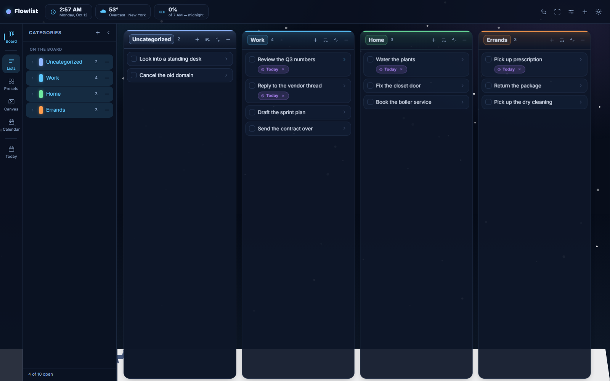
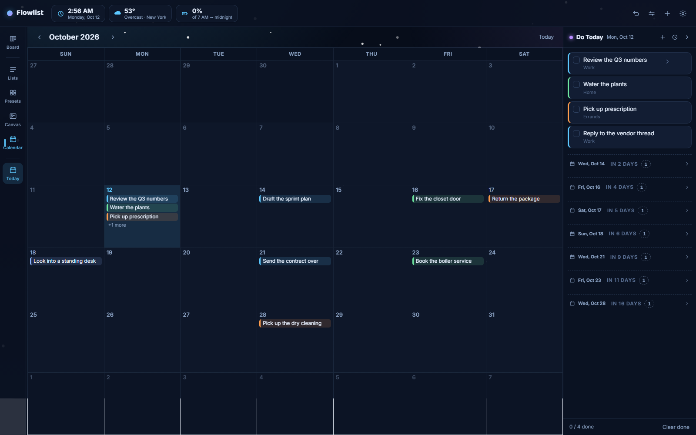
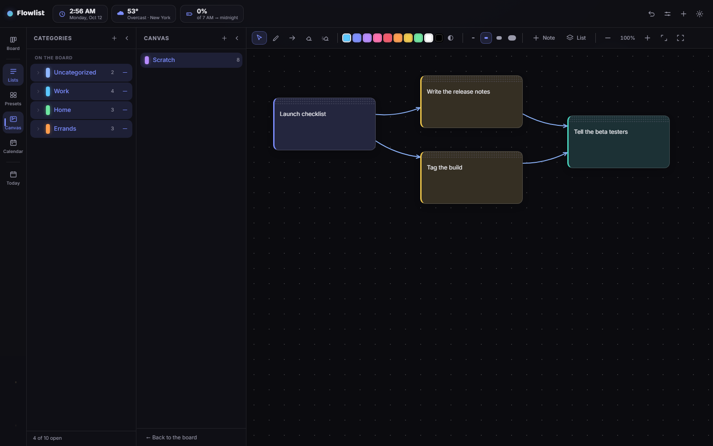
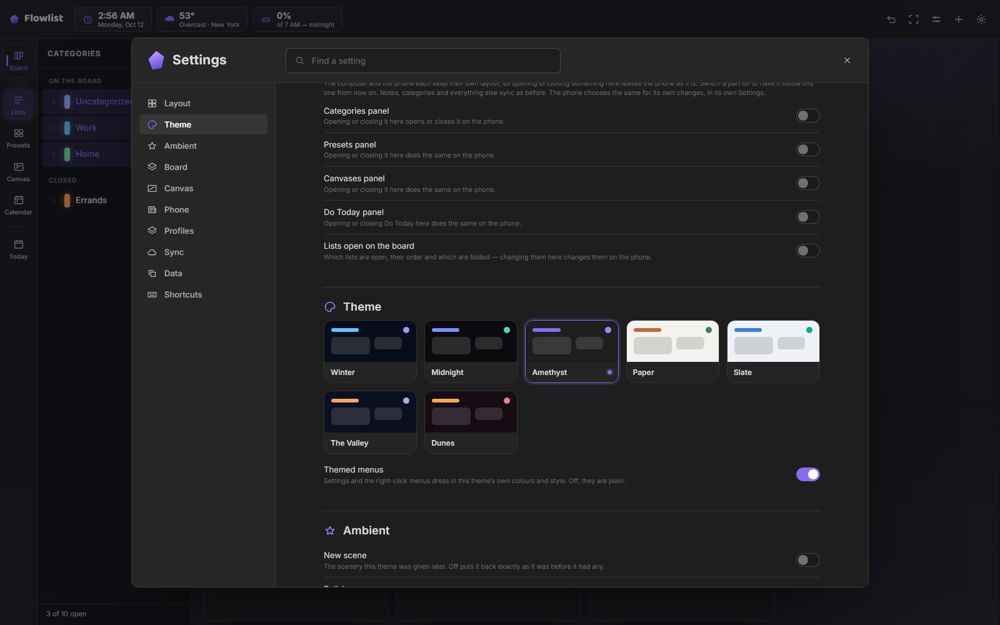
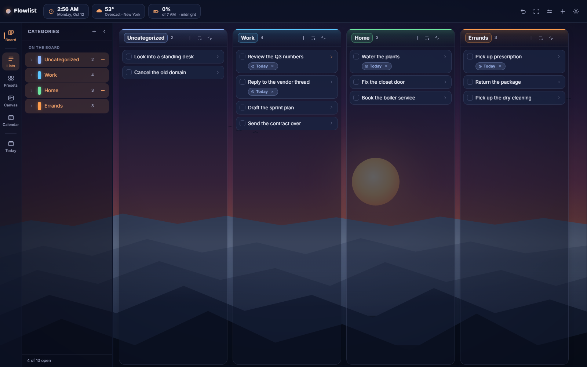

# Flowlist

A drag-and-drop to-do board, and two more surfaces beside it: colour-coded
categories as columns, a **Do Today** dock with an hour timeline that can push
reminders to your phone, a **calendar** you can schedule onto and write in, and
an infinite **canvas** with cards and connectors. Plus saved **presets** that
open a whole set of columns at once, a snap-in widget bar, and themes (including
a winter one with snowfall, a snowman and a wandering cat).

Rename it whenever you like — the name only appears in `index.html`'s `<title>`
and the top-left brand.



**No framework, no build step, no dependencies, no `package.json`.** Open
`index.html` and it runs — 29 JavaScript modules, about 13,500 lines, and 3,600
of CSS. It is tested by **52 suites and roughly 1,900 assertions that drive the
real page in headless Chrome**, not a mocked copy of it.

Sync between devices is **end-to-end encrypted**: the board is AES-GCM encrypted
in the browser under a key derived from your passphrase, and the database only
ever holds ciphertext. There is no recovery path and no plaintext fallback, by
design — it refuses to send rather than send in the clear.


## On a phone

The same site, the same data, a different shape. Nothing to install and no
second version to keep in step: `body.phone` restyles the markup that is
already there.

- the rail leaves the side and becomes a **bar along the bottom**, labels and all
- the side panels stop being columns and become **sheets over the board**, one at a time
- the board becomes **one column at a time**, filling the screen, swiped between with snap points
- Settings and the widget tray take the whole screen; touch targets grow; hover-only affordances (the grab line, the connector nubs) step aside

`Appearance → Layout → Shape` decides which you get:

| | |
|---|---|
| **Auto** | By the width of the window — the phone shape at 760px and under. Rechecked as the window changes or the phone turns. The default, and right without being asked. |
| **Phone** | Hold the phone shape whatever the device. |
| **Desktop** | Hold the wide shape, even on a phone. |

It is remembered per browser, like everything else, so a phone stays a phone and
a laptop stays a laptop. There is no separate mobile site to keep up to date and
no second address to remember — every feature added to one is in the other the
moment it lands.

## Running it

Double-click `index.html`. That's the whole install — no server, no build step,
no dependencies. It's plain HTML/CSS/JS, so it also drops straight onto any
static host (Netlify, GitHub Pages, Cloudflare Pages) as-is.

## Where your data lives

In your browser's `localStorage`, saved automatically on every change and flushed
immediately when the tab closes. **This is per-browser and per-machine** — it does
not sync between your laptop and your phone on its own — but it can, live, see
**Live sync between devices** below, and it can push reminders to your phone,
see **Phone notifications**.

`Appearance → Data` has **Export a backup** / **Import a backup** to move it by
file. A backup holds your notes and your settings but **not your sync
credentials** — the database address and room key are left out, because a backup
is a file you might email to yourself or leave in a shared folder, and it should
not be a way into your board — nor is the sync passphrase, if you set one. For the same reason, **restoring a backup never
changes this device's sync connection**: a file from another machine, or from
someone else, cannot quietly point this one at a different room. When you want real sync, everything funnels through `js/store.js`: replace
`load()` and `flush()` with a GET and a POST and nothing else has to change —
which is exactly what `js/sync.js` does, hanging off `Store.onPersist`.

## Live sync between devices

The whole board, on every device, within a second of a change. Type on the
laptop and it lands on the phone while you watch.

It uses a **Firebase Realtime Database** through its plain REST interface — a
`PUT` to send and an `EventSource` to listen. No SDK, no build step, no
dependency: the same file-you-double-click app as before.

It can be locked with a passphrase, so the database holds bytes nobody else can
read — see **Locking it before it leaves**.

### Setting it up, once

1. Make a free project at [console.firebase.google.com](https://console.firebase.google.com) — any name.
2. **Build → Realtime Database → Create Database.** Any region. Start in **locked mode**.
3. Open its **Rules** tab and paste the contents of
   [`firebase-rules.json`](firebase-rules.json), then Publish:

   ```json
   {
     "rules": {
       "rooms": {
         ".read": false,
         ".write": false,
         "$room": {
           ".read": true,
           ".write": "newData.exists()",
           "rev": { ".validate": "newData.isNumber()" },
           "at":  { ".validate": "newData.isNumber()" },
           "enc": {
             ".validate": "newData.hasChildren(['v', 'iv', 'data'])",
             "v":    { ".validate": "newData.isNumber()" },
             "iv":   { ".validate": "newData.isString() && newData.val().length < 64" },
             "data": { ".validate": "newData.isString()" },
             "$else": { ".validate": false }
           },
           ".validate": "newData.hasChildren(['rev', 'at', 'enc'])",
           "$else": { ".validate": false }
         }
       }
     }
   }
   ```

   They do three things worth having. `rooms` itself is unreadable, so nobody
   can list what rooms exist — a room has to be named to be reached. `.write`
   requires `newData.exists()`, so a write can add or change a room but never
   delete one. And the validators accept nothing but `rev`, `at` and the
   `enc` bundle, so the only thing that can be put in your room is a correctly
   shaped encrypted board.

   (`Appearance → Sync → Copy the rules to paste into Firebase` puts exactly
   these on your clipboard.)
4. Copy the database URL from the top of that page — it ends in
   `firebaseio.com`.
5. In Flowlist: **Appearance → Sync**, switch it on, paste the URL. A **room
   key** is generated for you.
6. On the other device: same URL, same room key. Press **Connect and pull what
   is there**.

### What the room key is

It is the password, and the only one. The rules above constrain the *shape* of
what can be written and stop the room list being read, but they are not access
control: anybody who can name your room can still read it and write to it. A
room nobody can guess is what keeps your board yours. That is why the key is
generated rather than invented, and why it is long. It is the same bargain as
the ntfy topic.

The board itself sits on Google's servers, unencrypted. If that is not
something you want, **Export a backup** is still there and still works.

### How two devices agree

Whole-document, last-write-wins, with a revision counter:

- every local change bumps the revision and sends the whole board
- an arriving board is adopted only if its revision is **higher** than yours
- adopting never sends anything back, so two devices cannot ping-pong

**It never pushes on the way in.** A device that opens pulls first and adopts
what is already there, so a freshly-opened phone with an empty board can never
wipe the laptop. If the room is empty, the first device to arrive fills it.

When only one side has changed, that is the whole story. When **both** have —
the phone edited offline while the computer edited online — the revisions alone
would throw one side's work away, so they are brought together instead. See
**When both devices have changed** below.

### Offline, and coming back

**This browser is always the real copy.** Every change is written to
`localStorage` first, exactly as it was before any of this existed — so the app
works with no signal at all. Edit on a train and the board is safe on the device
the moment you type it.

What sync adds is a note that something is **waiting to go out**. That note is
saved with everything else, so it survives closing the tab: a change made in a
tunnel is still marked unsent tomorrow morning. It goes the moment there is a
way out — when the browser says the signal is back, when the tab comes forward,
or on the next change, whichever is first. Failed sends retry on their own,
backing off as they go.

While something is waiting, **an arriving board is not adopted.** The change in
front of you would be the thing thrown away, so instead yours goes over the top
of what is out there, at a revision above it. Same last-write-wins rule, applied
from this end.

The status line says which of those it is: *Live*, *Connecting*, or **Saved
here, waiting for a way out**.

And because that line is in a panel you would have to go and open, a **banner**
comes up in the corner the moment a change cannot go out:

> ● **Offline — not syncing**
> Your change is saved on this device. It will go out on its own.

It stays while that is true — being offline outlasts a toast — and says **Back
in sync** for a few seconds when the change gets through, then leaves. One
banner, however many changes pile up behind it; a cross dismisses it for the
rest of that spell. `Appearance → Sync → Say so when it cannot go out` turns it
off, and the status line goes on saying the same thing either way.

### When both devices have changed

The awkward case: the phone edits something with no signal, the computer edits
something else online, and then the phone comes back. Neither should lose its
work.

Two versions of a board are not enough to work that out. If the phone has a
category the computer does not, that could mean the phone **added** it or the
computer **deleted** it, and there is no way to tell. So a third is kept: the
board exactly as it stood when this device and the room last agreed. With that,
it is obvious:

| | |
|---|---|
| in mine, not in the base | I added it → **keep** |
| in the base, not in mine | I deleted it → **stays deleted** |
| …and the same for the other side, worked out separately | |

So both devices' additions survive, a deletion on either side sticks rather than
being resurrected, and a note edited on one side only takes the edit. It happens
by itself when the connection comes back — no prompt to dismiss.

The one thing left is a **genuine clash**: the same field of the same note
changed to two different things. There is no clever answer to that, so it keeps
the copy on the device in front of you and *says so* rather than choosing
quietly. Different fields of the same note — you reworded it, the other device
gave it an hour — are not a clash and both apply.

**It does not stop to ask, and the version it set aside is not lost.** The log
records both, with the id of the thing they belonged to, and a button:

```
!  1 note had to be chosen   “Call parents”

   “Call parents” had its text changed on both.
     kept, from this device     Call parents at 11 pm
     set aside, from Computer   Call mum and dad tonight   [ Use this instead ]
```

Pressing it puts the other wording on the note; pressing it again swaps back. It
is a swap, not a one-way door. If that note has been edited since, or deleted,
it says so and leaves it alone rather than overwriting a newer change — which
would be the very thing this is meant to prevent.

Settings that belong to the device never travel: the sync keys, the layout
shape, which panels are open. A theme picked on one device does come across.

### The canvas

Everything on a canvas has an id, so it merges the same way the board does, and
one piece at a time rather than one canvas at a time:

- **draw on both devices** and every stroke survives — each swipe of the pen is its own thing
- **rub something out** on either device and it stays rubbed out
- **a card moved here and retyped there** takes both changes; they are different fields
- **paste a picture on each device** and both arrive
- **rename a canvas here, draw on it there** — both stand
- a **new canvas** made on each device gives you both

Two things are handled specially, because the obvious behaviour would be wrong:

**Where you are looking is not a disagreement.** A canvas stores its own pan and
zoom, so scrolling around on the phone while the laptop sits somewhere else
would otherwise read as a clash every single time. Pan and zoom stay with the
device, like which surface you are on and which canvas is open, and are never
reported.

**A connector needs both ends.** If one device deletes a card and the other
leaves a connector attached to it, the connector has nothing to hold on to —
it draws as nothing, so it is dropped rather than left in the data. An arrow
anchored to bare points rather than to cards is untouched.

**Moving the same card on both** is one disagreement, not two. It changes `x`
and `y` together, so the log says *position* once — “500, 200” against
“−100, 900” — and putting it back moves both.

One limit worth knowing: a board carrying **pasted pictures** can outgrow the
900 KB send cap, and then nothing syncs until it is under again. The banner says
so. Pictures are the only thing here big enough to do that.

### Locking it before it leaves

By default the room holds your board as plain readable JSON. Whoever runs the
database can read it. With a passphrase set, the board is encrypted on this
device and only the ciphertext is sent — the database stores bytes it cannot
open, and the passphrase never leaves the machines you type it into.

`Appearance → Sync → Passphrase`. Type the same one on every device that shares
the room. It is asked for once per device and remembered there.

**How it is done.** AES-GCM with a 256-bit key, from PBKDF2-SHA-256 over the
passphrase at 250,000 rounds. A fresh random 12-byte nonce for every single
send. All of it is the browser's own `crypto.subtle` — nothing is bundled here
and no cryptography is invented here.

The salt comes from the room key rather than being random, so two devices reach
the same key from the same passphrase without having to agree on anything
first. The room key is fourteen random characters, unique to you, which is what
a salt is for.

**What is still in the clear.** Two fields: the revision number and the time of
the last change. Both are needed to tell whether an arriving copy is newer
without decrypting it first. The device name travels *inside* the ciphertext.
So an onlooker learns that a board exists and roughly how often it changes, and
nothing else — not a note, not a category, not a name.

**What it costs.** Nothing you can feel. Deriving the key takes about 40 ms,
once per device per session, and the key is then held in memory. Encrypting a
typical board is a tenth of a millisecond per save; the largest board sync will
send, 900 KB, is about 4 ms. Sends are already debounced by 1.2 seconds, so a
burst of typing encrypts once at the end.

**If you lose the passphrase** there is no way back into the synced copy — that
is what makes it worth doing. Nobody can reset it, including you. The board on
each device is untouched and still works; only the copy in the room becomes
unreadable, and setting a fresh passphrase overwrites it.

**The two ends must agree.** If this device is locked and the room holds a plain
copy, it says *another device is syncing this room unlocked — give it the
passphrase* and refuses, rather than quietly sending your notes back in the
clear. The other way round, a locked room with no passphrase here asks for one
instead of showing an empty board.

**It needs a trusted page.** Browsers only hand out `crypto.subtle` on a page
they consider trustworthy. Opening `index.html` from disk counts, as does
`localhost` and anything over `https` — so the ordinary ways of running this all
work. The one case that fails is hosting it over plain `http` on a remote
machine, and there the app refuses to send at all rather than quietly falling
back to plain text.

The passphrase is not in the board, not in the settings that sync, and not in a
backup file. It sits alone in `flowlist.syncpass.v1` on the device.

### What sync has done

Every merge is written down: the time, which device, what came in, what stayed,
what went, and anything it had to choose between. A banner says the short
version when it happens — *Brought together with Computer · 1 in from Computer,
1 of yours kept* — with **See what changed** on it.

`Appearance → Sync → What sync has done` opens the full list, newest first,
grouped by day:

```
TODAY
  8:24 PM  with Computer
    ←  1 category, 1 note came in from there   “Written on the computer”, “Ring the plumber”
    →  1 category kept from here               “Written on the phone”
    −  1 note removed                          “Old shopping list”
    !  1 note had to be chosen                 “Call parents”
       “Call parents” had its text changed on both — this device’s was kept.
```

The last sixty are kept. **Clear** forgets the list; it never touches the board.

The agreed-copy snapshot and this log live beside the board in their own
`localStorage` keys, not inside it — they are bookkeeping, and a backup file
should be your notes and nothing else. If either is missing (first run, or
storage full) the merge still works: without a base it cannot tell an add from a
delete, so it keeps both sides. Erring towards keeping things is the right way
to be wrong.

### The rest of it

- Changes settle for **1.2 seconds** before going out, so a flurry of typing is one send rather than thirty.
- A failed send keeps the board intact locally and says so in the status line; the next change tries again.
- A board over **900 KB** is not sent — a pasted picture is usually why — and it tells you rather than failing quietly.
- A tab coming back from the background pulls, in case it missed something while hidden.
- **Send this board now** forces a push; **Connect and pull what is there** forces the other direction.
- The status line says whether it is live, when the last change landed and which device it came from.

## The board

| Thing | How |
| --- | --- |
| Open a category | Click it in the **Lists** panel, or its `+` |
| Close a column | The `–` in its header — it returns to the panel, newest-closed at the top |
| Collapse a column | The collapse arrow in its header; it becomes a coloured spine. Click the spine to expand it again |
| Reorder columns | Drag a column by its header, left or right |
| Scroll sideways | The grab bar at the bottom, the mouse wheel over empty board space, or Shift+wheel |
| Rename | Double-click a column header, or right-click → Rename |

Five columns fit on screen by default (`Appearance → Board` changes it, 2–8).
Open a sixth and it arrives **collapsed** as a spine rather than being refused.
Collapsed spines don't count toward the limit — that's what they're for. If you
try to expand one while five are already open, you get told to collapse or close
something first.

## Panels

**Each surface remembers its own layout.** Closing Categories on the board
leaves it open on the canvas, and vice versa — neither one changes the other,
and each stays as you left it until you change it on that surface. Presets and
Today work the same way.

The **list of canvases** is the exception: it never opens on the board, since
there is nothing there for it to do. Going to the board puts it away and coming
back brings it out again — unless you had closed it yourself while on the
canvas, in which case it stays closed.

The **full-screen button** at the left of the top-right group clears the app out
of the way so you can look at the theme's backdrop — the sky, the snow, the
scenery — with nothing on top of it. Press it again or hit `Esc` to bring it
back.

How much it takes is up to you, in Settings → Board:

- **off** (the default) — the columns, the panels and the Today dock go, but the
  top bar and the rail stay. You can still see the clock and the widgets, and
  the rail still works: pressing anything on it steps back out and does what you
  asked.
- **on** — the frame goes too, leaving the backdrop alone on the screen. A faint
  button sits in the top-right corner to bring it back, and `Esc` still works.
  Keyboard shortcuts stay quiet while there is nothing on screen to see change.

Either way it changes nothing underneath. Your columns stay open, your panels
stay as they were, and it is deliberately **not saved** — reloading brings the
app back, because opening to an apparently empty page would be a poor surprise.
Going to the canvas steps out of it too, so you are never stranded.

The canvas keeps a different control at the right end of its toolbar: that one
clears just the side panels so the canvas fills the window, and each surface
remembers its own answer.

## Notes

- `+` in the column header adds a note at the **top**, pushing the rest down.
- Right-click anywhere in a column for its menu (add at top, add at bottom, rename, colour, collapse, close, clear finished).
- **Enter** adds a note directly below the one you're in; **Shift+Enter** is a line break.
- **Backspace** in an empty note deletes it and puts the cursor in the one above.
- The chevron on the right of a note opens a **detail box** — it grows as you type, then caps and scrolls internally so you can still see the notes around it.
- Drag notes up and down, between columns, or into **Do Today**.

## Do Today

Dragging a note here **references** it — it stays in its category, and gets a
`Today` chip. Right-click a note → **Time** to tag it with an hour (7 AM →
midnight).

The **+** in the dock header writes a note straight into the list — no column to
open, nothing to drag. It appears at the top with the caret already in it: type
and press **Enter**, or **Escape** (or leave it empty) to change your mind and
have it disappear again. The note itself lives in **Uncategorized**, which is
named under it, so it is a real note like any other — tick it off, give it an
hour, drag it into a column. If Uncategorized has been renamed away, the first
category takes it; if there are no categories left at all, one is made.

The clock button in the dock header switches to **timeline mode**: every hour
from 7 AM to midnight gets its own rule across the dock, the current hour is
highlighted, and anything untimed collects under *No time set*. You can drop a
note straight onto an hour to schedule it there.

An hour is also what a reminder hangs off — see **Phone notifications** below.

## Calendar

The third surface, beside the board and the canvas. A month at a time, with
three different truths in the grid and none of them invented for it:

- **Days to come** are the notes spoken for — anything given a date.
- **Today** is the Do Today pile, because today is not a date to this app.
- **Days gone by** are what was actually ticked off, read back from Completed.

Drag a note from Do Today onto a day to schedule it. Right-click a day and you
get what is already on it, grouped by category in board order, with whatever was
added straight onto the day first — those land in the inbox, so they are the ones
still waiting to be filed. Picking one opens it for writing **inside the menu**,
and **Add something for this day** opens a blank one the same way.

Do Today opens beside the month, because it is what you drag from, and it shows
a fold per later day underneath Tomorrow — soonest first.



## Phone notifications

Anything in Do Today that has an hour on it can be pushed to your phone before
that hour comes round. Four things at 10 PM arrive as four notifications, one
per task — not one lump.

The message is the hour it sits under, then the task:

```
In 30 min
10pm Call parents at 11 pm
```

It goes through [ntfy](https://ntfy.sh), which needs no account on either end.
Install the ntfy app from the App Store or Play Store, press **+**, and
subscribe to the topic word shown in **Settings → Phone**. That word is the
whole of the security: anyone who knows it can push to your phone, so the app
generates a long, odd one for you rather than letting you pick. **Copy** puts it
on the clipboard and **New** rolls a fresh one.

Everything else in that group:

| | |
|---|---|
| **How early it goes** | Minutes before the hour. 30 by default, 5 minutes to 3 hours. |
| **A second, earlier one** | A heads-up further out — set it to 50 minutes and you get a warning before the reminder. Off by default. |
| **How the time reads** | The bit at the front of every message: `10pm`, `10 PM`, `10:00 PM` or `22:00`. One setting, every time it appears. |
| **Heading** | The bold line above it: the time left, the app name, the hour again, or nothing. |
| **How loudly it lands** | ntfy priority. Urgent gets through a phone on silent; quiet arrives without a sound. |
| **Skip anything ticked off** | On by default — nothing is sent about a task already done. |
| **Send them ahead of time** | See below. Off by default. |
| **Server** | For a self-hosted ntfy. Leave it alone otherwise. |

The preview card under the topic shows exactly what your phone is going to get,
in your own wording, and changes as you change the settings. **Send one to my
phone now** posts that same message immediately, using your next real reminder
if you have one.

**The app has to be open** for a notification to go out at the moment it is due
— it is a page in a browser, and a closed page has no clock. Opening it late
still catches up: anything whose moment has passed but whose hour has not yet
arrived is sent when you get back, and if both alerts for one task were missed
only the later one goes, since two buzzes in a row for one thing is noise.

**Send them ahead of time** removes that limitation. Each reminder is handed to
ntfy the moment it is scheduled, with the delivery time attached, and ntfy holds
it — so it arrives on a shut laptop. The trade is that nothing can call one back:
if you change the wording, move the hour or remove the task afterwards, the
notification already sitting on ntfy's server still turns up as it was.

Sends are logged so a reload never buzzes twice, and the log is pruned a day
later.

### With sync on

Reminder settings travel with the board, so the topic, the lead times and the
wording are set once and every device agrees.

Two things need care once more than one device is running the same clock, and
both are handled:

**Only one device sends.** Otherwise two devices would both notice the same
reminder and your phone would buzz twice for one thing. The first device to look
takes the job on and writes down which it is; the others stand down.
`Appearance → Phone → Sent from` says which device that is, with a button to
take it over. With sync off the question never arises — there is only one clock.

**What has already gone out is never forgotten.** The list of sent reminders is
a record, not a preference, so when two devices come together their lists are
joined rather than one being chosen. Without that, a merge could drop the other
device's marks and send the same reminder again. A mark cleared on both devices
stays cleared.

The device that sends has to be open at the time — so if it is the laptop and
the laptop is shut, nothing goes out. **Send them ahead of time** is the answer
to that: reminders are handed to ntfy in advance and arrive whatever is running.
The two settings work well together.

## Presets

A preset is a named, coloured, ordered group of categories.

1. `+` in the **Presets** panel makes one (defaults to *Untitled*).
2. Click it to open its box, then drag categories in from the **Lists** panel.
3. Drag them up and down inside the box to set the order.
4. The `+` on the preset opens every category in it, in that order, to the right of whatever's already open.

While a preset's columns sit next to each other, a solid band in the preset's
colour runs across the whole run with its name on it, above each column's own
colour line.

## Canvas



The **Canvas** button in the left rail switches the main area from the board to
a free-form surface. You can keep as many canvases as you like — `+` in the
panel makes one, clicking a name opens it, right-click gives you rename, colour,
clear and delete.

The rail button takes you to the canvas and restores the layout you left it in.
Once you are there, pressing it again only shows or hides the list of canvases.
Lists, Presets and Today are plain panel toggles and never change which surface
you are looking at.

To get back, press **Board** at the top of the rail (or `B`, or **← Back to the
board** at the foot of the canvases column, or just click a category). Board
leaves your panels exactly as they were — it only changes which surface is
showing. The rail marks whichever of **Board** / **Canvas** you are currently
looking at.

**Tools** (left end of the toolbar, with keyboard shortcuts):

| Tool | Key | What it does |
| --- | --- | --- |
| Select | `V` | Drag cards. Drag empty space — or hold the scroll wheel anywhere — to pan. Drag a card's side dot onto another card to link them |
| Draw | `P` | Freehand, in the chosen colour and thickness |
| Arrow | `A` | Drag to pull an arrow — start and end on cards to link them, or anywhere for a loose arrow |
| Erase | `E` | Click a stroke, arrow or card to remove it |
| Rub out | `S` | Hold the button down and drag — everything the brush touches goes |

Colour and thickness pickers sit next to the tools and apply to strokes and
arrows alike. The ten colours are the eight category colours plus **white** and
**black** at the end; every swatch carries a faint ring so the two ends of that
row are still findable on a dark theme.

The **half-filled circle** at the end of that row swaps black and white in
everything already drawn on this canvas — every white stroke or arrow turns
black and every black one white — and turns the pen round with it, so the next
mark matches what you can suddenly see. It is a straight swap, so pressing it
again puts it all back. Marks in any other colour, and the colour of note cards,
are left alone. Useful the moment you change to a theme that swallows whichever
of the two you had been drawing in.

**Pasting a picture**

Copy an image anywhere — a screenshot, something from a web page, a photo — and
press **Ctrl+V** on the canvas. It lands as its own card, centred on the mouse.
Right-clicking empty canvas offers **Paste a picture here** as well; if the
browser will not hand the clipboard over on request it says so and asks for
Ctrl+V, which always works.

`Appearance → Canvas → Pasted pictures` sets how big they arrive, 10% to 200% of
the image's own pixels (default 100%). **The picture itself is never touched** —
only the box it sits in is scaled — so nothing is re-encoded and a picture
dropped in at 25% can be pushed back up to full size later with nothing lost.
Right-click one for **Smaller**, **Bigger** and **Its own full size**; those
scale about its middle so it does not wander off as it grows.

Pictures are stored with everything else in `localStorage`, which the browser
caps at around 5 MB for the whole site. If a paste would take it past that, the
card is taken straight back off again and you are told, rather than the save
failing quietly later on.

**Rubbing out** comes in two. **Erase** takes one thing per click. **Rub out**
is a brush: hold the button down and drag, and whatever passes under the circle
goes with it — strokes, arrows and cards alike.

What it takes is one *thing*, not one *area*. A stroke is a single swipe of the
pen, from putting it down to lifting it up, so a house drawn in six swipes loses
only the swipes the brush actually touches — drag along one wall and the other
five stay exactly where they are. Nothing hidden underneath a card is carried
off with it either: only the topmost thing under the brush goes.

Marks leave the screen the moment you touch them, but the canvas is only written
to when you let go, so a whole sweep counts as one change. Cards behave as they
do everywhere else — the card leaves the canvas and the note or category it came
from is untouched, which it says when it happens. An arrow with nothing left to
hold on to goes with the card.

**Putting things on it**

- **Note** drops a free sticky you can type into. Double-clicking empty space does the same, where you clicked. Drag it by the dotted grip at its top.
- **List** places one of your categories as a live card — it shows the real notes and updates when you change them on the board. You can also drag a category straight out of the **Lists** panel onto the canvas.
- **A single note** can be dropped anywhere on the canvas two ways: drag a row straight off a category card (it lands where you release it, still linked back), or open a category's twist arrow in the **Lists** panel and drag one of its notes across. Dropping a note that's already on the canvas moves it rather than duplicating it.
- The little ⤢ on any row of a category card **pulls that note out** as its own card, already connected back to the category. Right-click a category card → *Pull every note onto the canvas* does the whole lot in a ring.
- Cards that reference real notes stay in sync both ways, and disappear from the canvas if you delete the underlying note or category.

The twist arrow in the Lists panel works on the board too — those notes can be
dragged into an open column or into Do Today, same as any other note.

**Category cards that hold more notes than fit** do one of two things, your
choice in `Appearance → Canvas`:

- **Scroll** (the default) — every note is there, the card keeps a fixed height and the list scrolls inside it. A scrolling card is dragged by its header so the list stays scrollable.
- **+N more** — shows the first few and a `+N more` line counting the rest.

Either way, **Rows before it scrolls / counts** sets how many rows that is
(3–20, default 8).

**The wheel goes to whatever is under the pointer.** Inside a note's text box or
a scrolling category card it scrolls that, and only once it reaches the end does
it go back to panning the canvas — so a long note reads without the whole canvas
sliding away underneath it.

**Connectors** curve between cards and follow them as you drag. Each one keeps
the colour it was drawn in.

**Taking something off the canvas** — drag a card left onto the open panels. A
red target fades in over them the moment you lift a card, the card floats above
the panels so you can see what you are holding, and the target lights up when
you are inside it. Let go and the card leaves the canvas.

Nothing is deleted: a note card goes away but the note stays in its category, a
category card goes away but the category and all its notes are untouched. Drop
anywhere else and the card just moves. With every panel closed there is no
target, so a card dragged to the far left is safe.

The same works on the board — drag a column by its header onto the panels and it
closes, back into your Categories list.

**Getting around**

- Drag empty space to pan; two-finger scroll works too.
- **Hold the scroll wheel down and drag** to pan from anywhere — over a card, over a picture, with any tool in hand. It is the same drag as empty space, so you never have to find a gap first. (The browser's own middle-click autoscroll is turned off here so the two do not fight.)
- `Ctrl`/`⌘` + scroll zooms toward the cursor, or use the `−` / `+` buttons.
- Clicking the percentage resets to 100%; the ⤢ button fits everything on screen (`F`).
- The last toolbar button **hides every side panel** so the canvas fills the window — the rail stays so you can still reach Lists, Presets, Canvas and Today. Click it again to put the panels back the way they were.

`Appearance → Canvas` has a **Canvas scale** slider (25–300%), a toggle for the
dotted grid, and the **Pasted pictures** size above.

## Widgets

The `+` in the top-right opens the tray. Hovering a card brings it up to full
opacity and shows **ADD**; clicking drops it at the right-hand end of the bar.
The slider button turns on arrange mode — drag widgets left and right, and each
gets a delete badge.

Shipped: **Clock**, **Weather**, **Day progress**, **Today count**, **GIF/image**
(click to paste a URL), **Headlines** (your own lines, with arrows to page
through), **Line of the day**.

Weather uses [Open-Meteo](https://open-meteo.com), which needs no API key. Click
the widget to type a city. Offline, it says so and stays out of the way.

## Themes

Seven of them, under the gear icon, top-right. Switching plays a colour wipe
out of the card you clicked.

| Theme | |



| --- | --- |
| **Winter** | Deep navy. Snowfall, a snow drift, a snowman and a cat that patrols the bottom |
| **Midnight** | Plain, quiet dark — with a city skyline below, its windows coming on and off under a moon |
| **Amethyst** | Near-black with a violet accent, and a graph of linked notes turning slowly in the corner. The one theme whose scene ships switched off. See below |
| **Paper** | Warm off-white, with one folded plane crossing the sky and taking its time about it |
| **Slate** | Cool, plain light, two ridges in the distance and fog banks drifting across them |

The last two are **landscapes**: the picture from the password screen, whole,
behind the board, with the board itself going to dark glass over it. Each one is
the very scene `js/scenes.js` builds for that screen rather than a copy of it,
so the theme and the screen cannot drift apart.

| Landscape | |
| --- | --- |
| **The Valley** | Ridges going back into mist, birds now and then, and a sky that turns from dusk to night to dawn. Tinted a little, so the gaps between columns do not show the sky at full strength |
| **Dunes** | Sand catching the last of a huge low sun, haze between the ridges, then a moon and the odd shooting star |



### Amethyst

Near-black — `#1e1e1e` canvas, `#161616` sidebar, `#dadada` text — with a
`#8b6cef` accent purple, tighter corners, flat surfaces, and a faceted stone in
place of the round brand dot.

**Its graph starts switched off.** Amethyst is the one theme that ships quiet:
**Ambient → New scene** turns on a graph of linked notes drifting in the corner,
and until you ask for it the theme is colour alone. Every other theme draws its
scenery from the start.

**Ambient → Polish** switches between the two looks — off is plain and flat, on
adds the gradient card surfaces, the violet wash behind the board and the
shimmer on the brand stone. It is the same switch every theme has (see below),
and Amethyst simply has more hanging off it.
### Things that react to your cursor

Every one of these has its own switch under **Ambient**, and all default to on.

| Switch | Where | What it does |
| --- | --- | --- |
| **Cursor wind** | any theme with particles | Snowflakes swerve around your pointer and trail along in its wake |
| **Settling snow** | Winter | Flakes that land build a bank along the bottom over the session. Sweep the cursor through it and it ploughs aside |
| **Comes when called** | Winter | The cat notices the cursor when it comes down near the floor, drops its patrol, trots over and paws at it — then goes back to patrolling when you leave it be |
| **Confetti** | every theme | A burst in the theme's colours when you tick off the last thing in Do Today |

Cursor wind sits nested under the particle row it affects, so it disappears if
you turn the particles off. Confetti is the only one that shows on every theme,
since it does not depend on any scenery.

### Polish

Every theme has its own **Polish** switch at the top of **Ambient**, and each
one remembers its own answer — turning it off for Winter leaves Midnight
polished.

On (the default) is the app as designed. Off strips the decoration back: no
gradient wash behind the board, no drop shadows on columns, cards or widgets, no
glow on the coloured spines, swatches or tags, and no shimmer on the brand mark.

What it deliberately does **not** touch: the palette is identical either way, the
coloured spines keep their colours so you can still tell columns apart, and
floating things — menus, the Appearance drawer, the widget tray — keep their
shadows, because those are structural rather than decoration and without them
they stop reading as sitting on top.

### Hold it still

Under **Scenery** there is **Hold it still**. The scene is built exactly as it
always is — the ridges, the skyline, the snowman and the cat — and then nothing
in it moves. No swaying, no twinkling, no walk, no physics.

This is the difference between a page that animates 60 times a second for as
long as the tab is open and one that paints itself and then goes quiet. If you
keep the app open all day on a laptop, it is the setting that matters: you get
the whole backdrop and the machine gets to idle.

The rows that only mean anything while it moves — *Comes when called* — fold
away while it is held, since there is nothing for them to do. *Walking cat*
stays, because whether there is a cat at all is a separate question from
whether it walks.

Nothing about the picture changes. It is the same scene either way.

### Ambient is theme-aware

The **Ambient** section only lists what the current theme actually has — no more
greyed-out rows for a snowman on a theme with no snow.

**Every theme has scenery of its own** — see the table above — so every one of
them offers the Scenery switch and **Hold it still**.

Four of those themes had nothing behind them to begin with and were given a
scene later: Amethyst, Midnight, Paper and Slate. Each keeps a **New scene**
switch at the very top of Ambient — above Polish, because everything below it
belongs to the scene it turns on. Off, that theme goes back to exactly what it
was before it had one: an empty backdrop, and no scenery rows in the panel at
all. It is remembered per theme, so you can keep the city in Midnight and have
Paper plain. **Amethyst is the one that ships with it off.**

It is there for performance as much as for taste: with it off, that theme is
back to the state it was in before any of this — **nothing running at all**,
which the tests check theme by theme rather than take on trust. It is the
known-quiet fallback, with **Hold it still** as the middle setting: the whole
picture, and still nothing running.

What differs beyond that is the rest: Winter adds snowfall and the cat, the
landscapes add their own sky, and the quiet themes add nothing else. Rows that
depend on another (the cat needs scenery; the splash sliders need the splash)
sit indented beneath it and appear and disappear with it.

One rule of the house, enforced by the tests: **an animation that never ends may
only move `transform` or `opacity`.** Those two are handed to the compositor;
anything else — a filter, a box-shadow — repaints the element on every frame for
as long as the tab is open, which is enough on its own to keep a laptop from
ever idling. Three animations broke that rule and have been rewritten.

## Splash screen

`Appearance → Ambient` has the on/off toggle and, under it:

- **How long it holds** — a slider in milliseconds (0–6000, in steps of 50, default 2000). The readout shows both, e.g. `2450 ms · 2.5s`; 0 reads as *off*. The progress bar on the splash is timed to whatever you pick, so it always finishes as the splash lifts.
- **Catchphrase size** — the type size of the rotating line, 10–32px (default 14). Long phrases wrap and stay centred rather than running off the edge.

**Preview it** closes the drawer and replays the splash over the running app —
with a fresh catchphrase — so you can judge the length without reloading.

## Keyboard

The left rail, top to bottom: **Board** and **Canvas** switch surface; **Lists**,
**Presets** and **Today** open and close their panels.

| Key | Does |
| --- | --- |
| `[` | Lists panel |
| `P` | Presets panel |
| `T` / `]` | Do Today |
| `C` | Canvas |
| `B` | Back to the board |
| `N` | New note in the leftmost open column |
| `,` | Appearance drawer |
| `Esc` | Close menus, drawers, or cancel a drag in progress |

While a canvas is showing it takes `V` / `P` / `A` / `E` for its tools and `F`
for fit, so those don't reach the panels.

## Layout of the source

```
index.html          markup shell — everything else is built by JS
css/base.css        reset, app shell, splash, primitives
css/components.css  panels, columns, notes, Today, presets, widgets
css/menus.css       settings drawer and context menus, and each theme's skin for them
css/calendar.css    the month grid and its day panel
css/canvas.css      the canvas surface, cards, toolbar
css/themes.css      the theme token sets + every scene
css/scenes.css      the landscape scenes, shared with the password screen
css/mobile.css      the phone shape, all of it behind body.phone
css/fonts.css       the embedded fonts (base64 — do not open it, it is not readable)

js/profiles.js      more than one board on one machine; every storage name goes through it
js/keyfile.js       the key file on a USB stick, the backup passphrase, and the wrapping
js/unlock.js        the screen that asks for the key or the words
js/store.js         all state, persistence, pub/sub — the only thing that mutates data
js/shortcuts.js     the keyboard map
js/dnd.js           one pointer-driven drag engine, used by every draggable thing
js/doubletap.js     double-tap and long-press, for the phone
js/rename.js        the rename popover
js/menu.js          icons, context menus, toasts
js/when.js          the date-and-hour picker, mounted inside an ordinary menu
js/lists.js         categories panel, the board, notes, the grab line
js/today.js         the Do Today dock and its hour timeline
js/presets.js       presets panel, firing them, the colour bands
js/dropzone.js      where a dragged thing may land
js/canvas.js        canvases, drawing, cards, connectors, pan and zoom
js/calendar.js      the month, scheduling onto a day, and the day menu
js/widgets.js       widget catalogue, the bar and the tray
js/confetti.js      the flourish when a list empties
js/ntfy.js          the reminder clock and its pushes to ntfy
js/offline.js       the service worker's side of being offline
js/fullscreen.js    hiding the side panels
js/mobile.js        the phone shape: when to use it, and what it changes
js/layouts.js       which surfaces and panels are up, per shape
js/merge.js         three-way merge: base, mine, theirs, with a report
js/sync.js          live sync through a Firebase Realtime Database
js/scenes.js        the landscape scenes, drawn for the password screen and the themes
js/lock.js          the passphrase screen and its wrong-try limit
js/themes.js        themes, particles, the scenes and the scene clock, settings drawer
js/app.js           bootstrap, splash, panels, view switching

bundle.sh           folds the whole app into one .html a phone can open
firebase-rules.json the database rules — paste these into Firebase
tests/              the suites, the runners, and tests/perf for speed
android/            builds the APK without Gradle (see android/setup-toolchain.sh)
site/               the hosted PWA: service worker, manifest, icons
tools/              a static file server, the icon generators
screenshots/        the images in this README
```

Canvas coordinates are stored in *world* units — screen position is
`world × zoom + pan` — so everything keeps its meaning at any scale.

Adding a widget means one entry in `TYPES` in `js/widgets.js`. Adding a theme
means one `[data-theme="…"]` block in `css/themes.css` and one line in `THEMES`
in `js/themes.js`.

## Not built yet

- **The "additions" layer** — animated companions beyond the winter cat.
- **A real news feed.** The Headlines widget rotates lines you write. Every free news API needs a key and blocks browser-side calls, so a live feed needs a small proxy.
- **Touch drag on a tablet.** The phone layout is built and tested; a tablet falls between the two and has not been tried on real hardware.
- **Recurring notes, due dates, search.**

## Licence

None, and that is deliberate. This is here to be read rather than reused, so
the default applies: all rights reserved. Look at how any of it works — that
is what it is published for.
